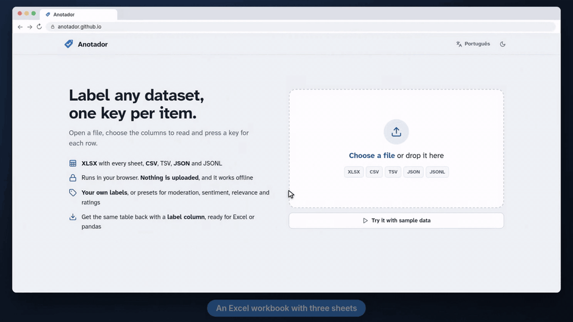

  

<h1 align="center">Anotador</h1>

Label any dataset one item at a time, with the keyboard. 
Moderation, sentiment, relevance, answer checking, model output review and more. 
A single HTML file that runs in your browser: no installation, no server, no upload.

<a href="https://anotador.github.io"><strong>Open Anotador</strong></a>

## Demo

Click the animation for the full narrated video (1 min 36 s, with captions): an Excel workbook with three sheets, a CSV and a JSON file, from opening the file to downloading the labeled CSV. It also plays at the bottom of [the page](https://anotador.github.io).

## What it does

- **Opens your file as it is:** XLSX (every sheet), CSV, TSV, JSON and JSONL.
- **Shows only what matters:** you pick which columns appear, what each is called and in what order. Hidden columns still go to the output.
- **One key per item:** press the key of a label and the next item appears. Arrow keys move back and forth.
- **Labels your way:** 22 ready-made sets in four groups, or your own. Each label has a key, a color (five ready-made or any hex code) and an optional description shown under its button.
- **Fits the task:** instructions for annotators, columns side by side, drag and drop to reorder columns and labels, an optional notes box, shuffled order, and the choice of staying on an item until you move on.
- **Gives the table back:** download a CSV with your original columns plus `label`, the annotator, the time spent and when each item was answered.
- **Keeps your progress:** saved in the browser as you go, per file, per sheet and per annotator. Reopen the file to continue.
- **Shares the work:** make a single HTML page with the data and labels inside, so a second annotator only types a name and starts.
- **Speaks two languages:** English and Portuguese, following the browser, with a button to switch.
- **Light and dark:** follows your system, or pick one with the sun and moon button.

## Supported files

| Format | Extensions | Details |
| --- | --- | --- |
| Excel | `.xlsx`, `.xlsm` | Reads every sheet. With more than one sheet, pick one or **All sheets together**, which adds a `sheet` column with the origin of each row. A sheet without a header row and at least one data row is left out. Dates become `YYYY-MM-DD` (with the time when there is one), booleans become `TRUE` or `FALSE`, rich text becomes plain text. The old `.xls` format is not supported: save it as `.xlsx`. |
| CSV | `.csv`, `.txt` | The separator is detected (comma, semicolon, tab or pipe). Quoted fields with line breaks and quotes inside work. UTF-8 or Windows-1252. |
| TSV | `.tsv` | Tab separated. |
| JSON | `.json` | A list of objects, or an object that contains such a list. |
| JSONL | `.jsonl`, `.ndjson` | One JSON object per line. |

In tables, the first non-empty row is the header. A cell or field holding a list of messages with `role` and `content` is shown as a conversation; other JSON values are shown formatted.

Each item is identified by a column named `id`, `_id`, `uid`, `idx`, `index`, `item_id`, `id_item`, `item`, `key` or `chave` when its values are unique, or else by the row number. You can choose another column in the settings.

## How to use

1. Open the page and choose a file, drop it on the page, or click **Try it with sample data**.
2. Tick the columns to show, rename them and drag them into order. In a workbook with several sheets, pick the sheet.
3. Choose a label set in **Preset** and adjust it: rename, change keys, pick a color or type any hex code, add a description, drag to reorder. A key cannot belong to two labels.
4. Optionally write **Instructions** for annotators, rename the label column, and turn on **Shuffled order**, **Notes box** (a free text note per item, saved in a `note` column), **Columns side by side** or off **Next item after labeling**.
5. Type the annotator's name and click **Start labeling**.
6. Press a label key for each item. **Download labeled CSV** works at any moment.

| Key or button | What it does |
| --- | --- |
| Label key (`1`, `2`, `3`...) | Labels the item and goes to the next one. |
| `←` and `→` | Previous and next item. |
| `Esc` | Leaves the notes box so the label keys work again. |
| `↑` and `↓` on a drag handle | Move that column or label up or down in the settings. |
| Next unlabeled | Jumps to the next item without a label. |
| Go to | Jumps to an item number. |
| Download progress, Import progress | Move your work to another browser or computer as a JSON file. |

## Label presets

Every preset uses the keys `1`, `2`, `3` and so on, in order. After choosing one, each label can still be renamed, recolored or removed, and new ones added.

| Group | Presets |
| --- | --- |
| Safety and moderation | Benign / Harmful / Ambiguous (default), Safe / Unsafe, Complied / Partly complied / Refused, Toxic / Not toxic, Hateful / Offensive / Neither, Spam / Not spam, Personal data / No personal data |
| Quality and correctness | Correct / Incorrect, Correct / Partly correct / Incorrect, Factual / Hallucinated / Can't verify, Relevant / Partly relevant / Not relevant, Accurate / Minor errors / Major errors / Unusable (translation), Rating 1 to 5 |
| Text classification | Positive / Neutral / Negative, Joy / Sadness / Anger / Fear / Surprise / Neutral, In favor / Against / No stance, Question / Request / Complaint / Praise / Other |
| Review and comparison | A is better / Tie / B is better, Agree / Disagree / Unsure, Keep / Discard / Review, Duplicate / Not duplicate, Yes / No / Unsure |

## Output CSV

All original columns come first, including the hidden ones, followed by:

| Column | Content |
| --- | --- |
| `label` | The chosen label, empty if the item was not labeled. The column name can be changed in the settings. |
| `note` | The note typed for the item. Only when **Notes box** is on. |
| `seconds` | Time spent on the item, counted only while the tab is visible. |
| `annotator` | The annotator's name, on labeled rows. |
| `answered_at` | When the label was chosen, in ISO 8601 (UTC). |

The file is UTF-8 with a byte order mark, so Excel shows accents correctly, and keeps semicolons if the input used them. If an original column already has one of these names, the new one gets `_new` at the end. The file is named `<file>[-<sheet>]-labeled-<annotator>.csv`, for example `responses-labeled-ana.csv`.

The column names are the same in both interface languages, so CSVs from different annotators can be merged directly.

## Sharing with another annotator

In the settings, click **Make a page for another annotator**. You get one HTML file with the data, the visible columns and the labels inside. The other person opens it, types their name, labels and sends back the CSV, with no setup and no internet.

The data travels inside that file, so only send it to people who may see the data.

## Privacy

- Your file is read by your browser and never uploaded. The page has no server, no analytics and no third-party scripts.
- The only files the page loads besides itself are its two font files, from the same folder. Without them it falls back to the system font.
- Progress lives in your browser's `localStorage`. Clearing the site data removes it, and **Delete my labels** removes the current annotator's labels for the current file.
- The online page and a local copy keep separate progress. Use **Download progress** and **Import progress** to move between them.

## Run it offline

Download this repository (Code, Download ZIP) and open `index.html` in your browser. It also works with `index.html` alone, using the system font.

## Browser support

Current Chrome, Edge, Firefox and Safari. Opening XLSX needs `DecompressionStream` with `deflate-raw` (Chrome and Edge 103+, Firefox 113+, Safari 16.4+); CSV, TSV, JSON and JSONL do not.

## Examples

The `examples` folder has one file per format, each suited to a different preset:

| File | Content | Try with |
| --- | --- | --- |
| [`workbook.xlsx`](examples/workbook.xlsx) | Three sheets (Support, Reviews, Forum) of user messages with a `model_verdict` column to hide | Benign / Harmful / Ambiguous |
| [`responses.csv`](examples/responses.csv) | Quiz questions and a model's answers | Correct / Incorrect |
| [`conversations.json`](examples/conversations.json) | Customer support chats | Positive / Neutral / Negative |

## License

MIT. See [LICENSE](LICENSE).

## Credits

- Icons from [Lucide](https://lucide.dev), ISC License, embedded in the HTML.
- Font [Atkinson Hyperlegible Next](https://github.com/googlefonts/atkinson-hyperlegible-next) by the Braille Institute, SIL Open Font License 1.1 (see [`fonts/OFL.txt`](fonts/OFL.txt)).
- Demo narration: the voice Brittney, from the ElevenLabs voice library.
